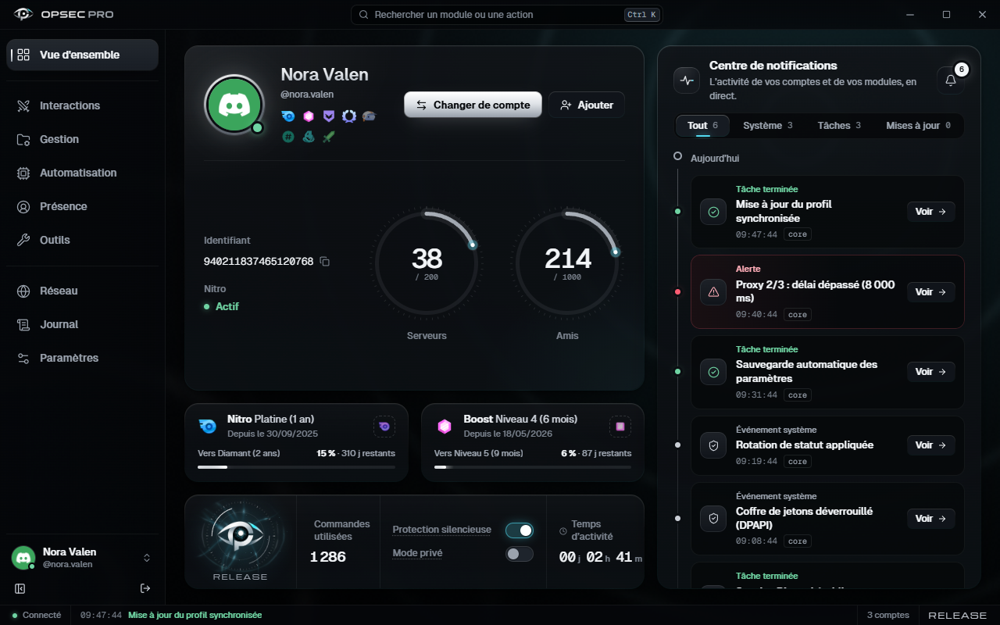
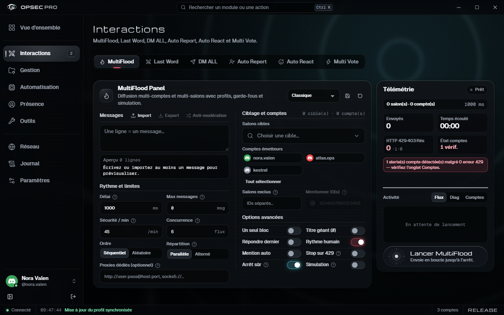
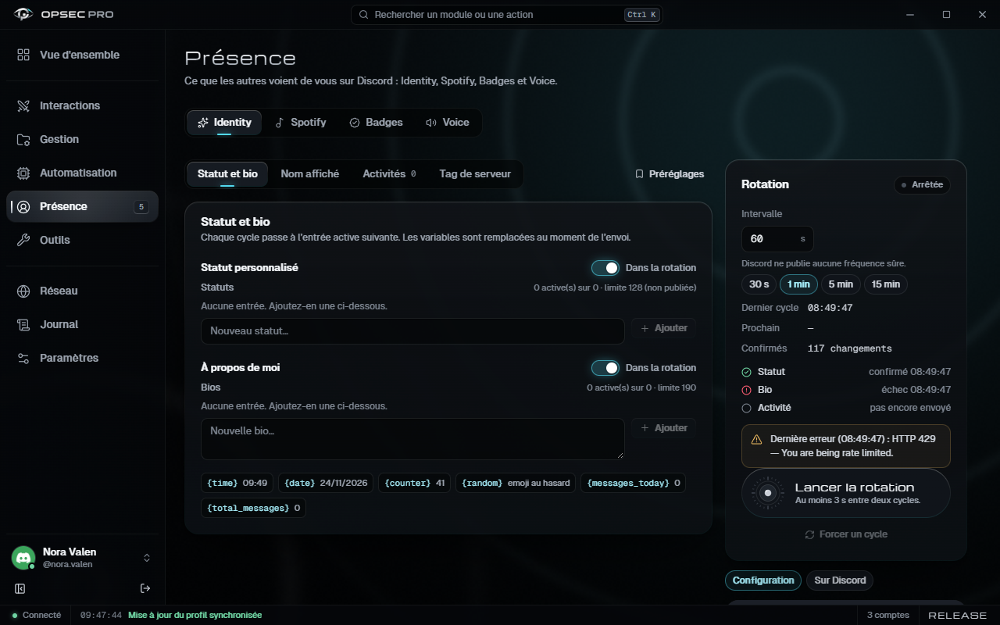
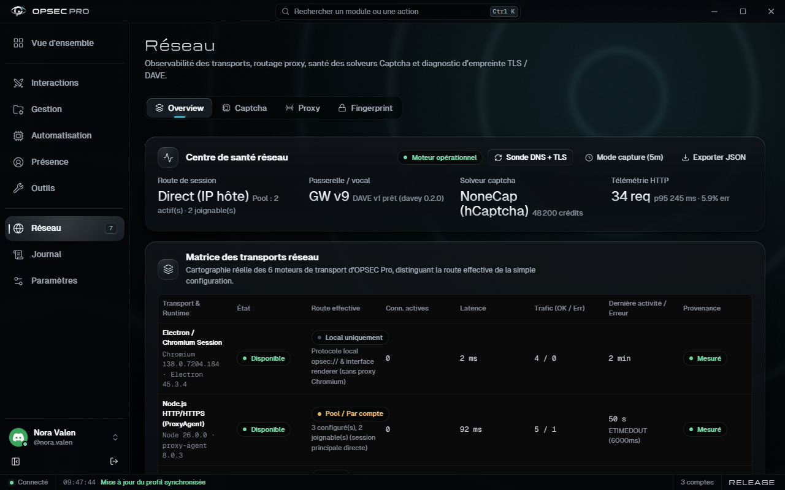
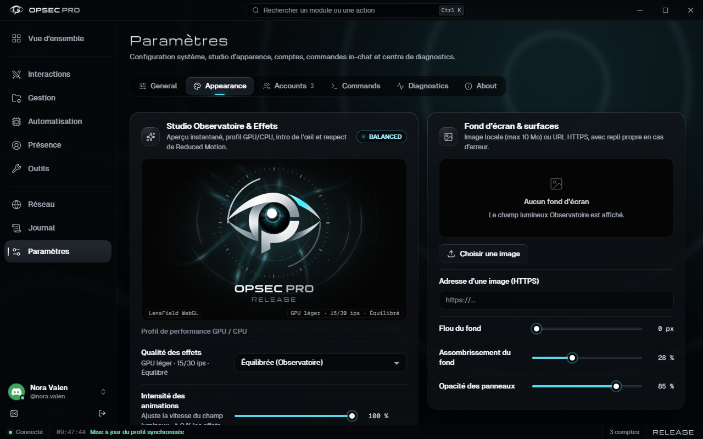
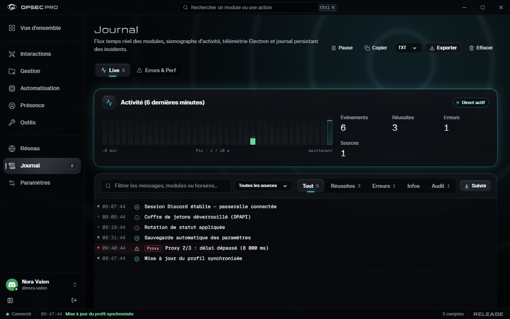

<div align="center">


# OPSEC Pro

**Observatoire Edition · Canal public `RELEASE` · Windows 10 / 11 (x64)**

Suite de gestion multi-comptes, de présence temps réel, d'automatisation contrôlée, de diagnostic réseau et de protection pour Discord sur Windows.

[**Télécharger `OPSEC-Pro-RELEASE-Setup.exe`**](https://github.com/ellecrydansmesdm/opsec-pro/releases) · [**Serveur Discord Officiel**](https://discord.gg/W2YgEStqJ4) · [**Signaler un problème**](https://github.com/ellecrydansmesdm/opsec-pro/issues)

</div>

---

<p align="center">
  
</p>

---

## Présentation

**OPSEC Pro (`RELEASE`)** est une application de bureau native construite autour du système visuel et sonore **Observatoire** (WebGL2 `LivingEye`, champ optique `LensField`, navigation instantanée sans écran noir, palette sonore *Matte Instrument*, bilingue Français / Anglais).

L'ensemble des jetons Discord, clés de solveurs CAPTCHA, cookies Spotify, webhooks et mots de passe de proxys sont chiffrés localement sur votre poste via l'API **Windows DPAPI (`Electron safeStorage`)** et ne quittent jamais votre machine vers nos serveurs. La validation de licence s'effectue exclusivement par HTTPS (`TLS 1.3`) auprès de notre infrastructure dédiée, avec liaison matérielle atomique (`HWID`) et délai de grâce hors ligne de 7 jours.

---

## Modules effectivement distribués (`RELEASE`)

### 1. Overview (Vue d'ensemble)
- Tableau de bord unifié du compte actif, badges Discord 2026 (40 paliers Nitro / Boost & progression d'ancienneté), jauges temps réel (serveurs, amis), contrôles rapides **Protection silencieuse** & **Mode privé**, bascule multi-comptes instantanée et centre de notifications en direct.

### 2. Interactions
- **Spam** & **MultiFlood** — Envoi séquentiel ou multi-comptes avec limites de débit configurables, gigue (*jitter*), arrêt automatique sur rate-limit (`429`) ou restriction, mode simulation (*dry-run*) et routage proxy par compte.
- **DM All** & **Server DM Bot** — Diffusion contrôlée avec pause automatique sur rate-limit et suivi individuel.
- **Last Word**, **Multi Vote** & **Auto React** — Réponses ciblées, votes multi-comptes et réactions automatisées avec prévisualisation et plafonds de sécurité.
- **Auto Report (Moteur local d'analyse)** — Détection locale de motifs (normalisation Unicode/homoglyphes, protection anti-ReDoS) et file de revue manuelle sans signalement abusif automatisé.

### 3. Management (Gestion)
- **Purge** — Suppression contrôlée de vos propres messages par salon ou serveur avec aperçu préalable et délai anti-rate-limit.
- **Cleanup (Sanitizer)** — Nettoyage sélectif de serveurs, groupes DM, messages privés et relations avec arrêt d'urgence immédiat.
- **Cloner & Backups** — Sauvegarde locale de structure de serveur (rôles, catégories, salons, permissions) et restauration contrôlée.
- **Snipe (Historique local)** — Consultation locale en mémoire des messages supprimés ou modifiés observés durant la session.

### 4. Automation (Moteur)
- **Auto Responder** — Règles conditionnelles (`AND`/`OR`, préfixes, exclusions, variables dynamiques, refroidissement par salon/utilisateur et testeur à blanc intégré).
- **Macros** — Scénarios multi-étapes avec capture d'instantané (*snapshot*) du profil Discord et restauration atomique en cas d'annulation.
- **Farming** — Activité vocale et textuelle cadencée avec simulation de frappe et mode discret.
- **Nitro Sniper (Passif)** — Détection passive des liens cadeaux et suivi d'échéances de giveaways avec ouverture manuelle sécurisée (aucun auto-claim abusif).

### 5. Presence (Présence)
- **Identity & Rotator** — Statuts personnalisés, Rich Presence (RPC), rotation programmée (statut, bio, activité, tag de clan) et détection optionnelle de jeux/applications locales.
- **Spotify Sync** — Synchronisation paroles LRC temps réel (`LRCLIB` + source locale Windows `GSMTC`) et éditeur de paroles personnalisées.
- **Badges** — Inspecteur complet des badges Discord et simulation locale de paliers.
- **Voice 24/7 (DAVE E2EE)** — Connexion vocale persistante avec reconnexion exponentielle plafonnée, lecteur audio Opus et prise en charge du chiffrement vocal de bout en bout Discord **DAVE** (`@snazzah/davey`).

### 6. Tools (Outils)
- **Usernames (Pomelo)** & **Vanity Watcher** — Surveillance de disponibilité de pseudos et d'URL personnalisées avec listes de suivi importables/exportables et alertes Webhook Discord (protégées contre le SSRF).
- **Groups & Sentinel** — Gestion de groupes DM et protection **Sentinel** contre les retraits non intentionnels.

### 7. Network (Réseau)
- **Overview (Diagnostics)** — Cartographie réelle des transports réseau (Chromium, Node HTTP/ProxyAgent, Gateway WebSocket, Voice UDP/DAVE), sondes DNS & TLS en direct et télémétrie HTTP.
- **Captcha** — Gestionnaire unifié multi-fournisseurs (*CapSolver, CapMonster Cloud, 2Captcha, Anti-Captcha, NoCaptchaAI, NoneCap, CaptchaAI*), vérification de solde et benchmark local contrôlé.
- **Proxy & Fingerprint** — Pool de proxys HTTP/SOCKS5 testés sur cible réelle (masquage automatique des identifiants dans tous les journaux) et cohérence des en-têtes `X-Super-Properties`.

### 8. Journal & 9. Settings (Paramètres)
- **Journal** — Flux temps réel avec sismographe d'activité, filtrage par module, mise en pause, export (`TXT` / `JSON` / `CSV`), télémétrie CPU/RAM par processus et inspecteur d'erreurs disque (`errors.jsonl` expurgé de tout secret).
- **Settings** — 6 onglets (*General, Appearance, Accounts, Commands, Diagnostics, About*) : profils sonores, studio visuel GPU/WebGL, coffre multi-comptes avec revérification des jetons, registre des commandes In-Chat et sauvegardes signées `SHA-256`.

---

## Aperçu de l'interface Observatoire

<p align="center">
  
  
</p>
<p align="center">
  
  
</p>
<p align="center">
  
</p>

---

## Installation & Vérification d'intégrité

1. Téléchargez **`OPSEC-Pro-RELEASE-Setup.exe`** (ainsi que `OPSEC-Pro-RELEASE-Setup.exe.sha256`) depuis la page officielle [**Releases**](https://github.com/ellecrydansmesdm/opsec-pro/releases).
2. *(Recommandé)* Vérifiez l'empreinte `SHA-256` dans PowerShell avant exécution :
   ```powershell
   Get-FileHash .\OPSEC-Pro-RELEASE-Setup.exe -Algorithm SHA256
   ```
3. Exécutez `OPSEC-Pro-RELEASE-Setup.exe` sur **Windows 10 ou Windows 11 (64 bits)**.
4. Activez votre clé de licence `OPSEC-…`, puis connectez votre compte Discord.

---

## Architecture & Sécurité d'exécution

- **Isolation Electron stricte** : `contextIsolation: true`, `sandbox: true`, `nodeIntegration: false`, politique `Content-Security-Policy` verrouillée, validation d'origine des trames IPC (`senderFrame`) et garde de licence côté processus principal.
- **Intégrité binaire (Electron Fuses)** : `RunAsNode` désactivé, `EnableNodeOptionsEnvironmentVariable` désactivé, `EnableNodeCliInspectArguments` désactivé, `EnableCookieEncryption` activé, `OnlyLoadAppFromAsar` activé et validation d'intégrité `ASAR` embarquée (`EnableEmbeddedAsarIntegrityValidation`).
- **Mises à jour vérifiées** : Téléchargement HTTPS restreint aux releases officielles GitHub et vérification obligatoire de somme de contrôle `SHA-256` avant tout lancement d'installeur.

---

## Avertissement

OPSEC Pro interagit avec Discord à l'aide de jetons de comptes utilisateurs. L'automatisation d'un compte utilisateur (*selfbot*) contrevient aux Conditions d'Utilisation de Discord et expose les comptes concernés à des mesures de restriction ou de suspension. L'utilisateur assume l'entière responsabilité de l'usage qu'il fait du logiciel et du respect des lois applicables.

---

## Liens officiels

- **Discord** : [https://discord.gg/W2YgEStqJ4](https://discord.gg/W2YgEStqJ4)
- **Téléchargements (`RELEASE`)** : [https://github.com/ellecrydansmesdm/opsec-pro/releases](https://github.com/ellecrydansmesdm/opsec-pro/releases)
- **Support & Tickets** : via le serveur Discord officiel (`#tickets`)
